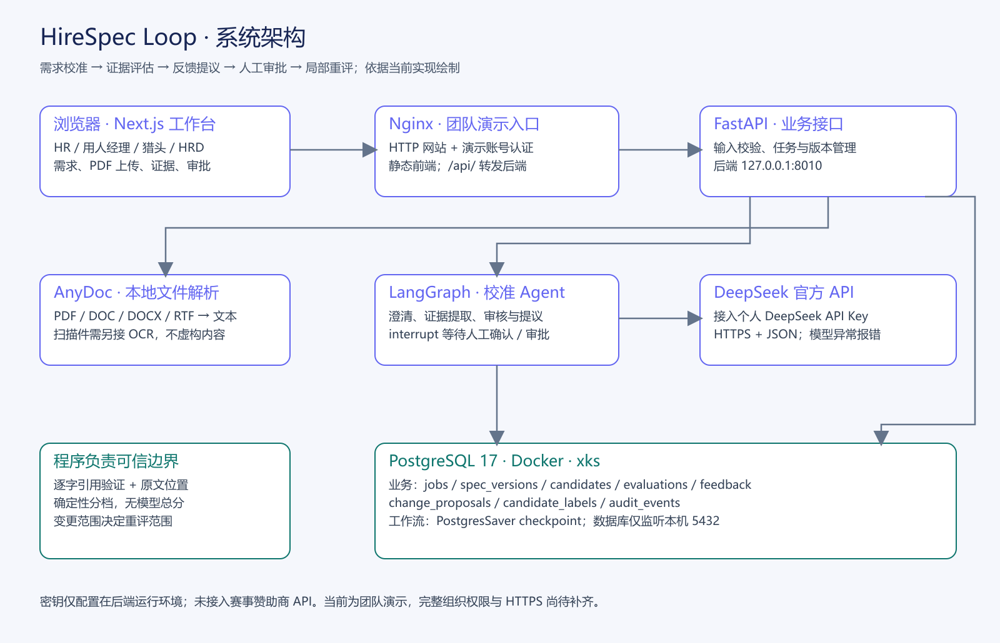
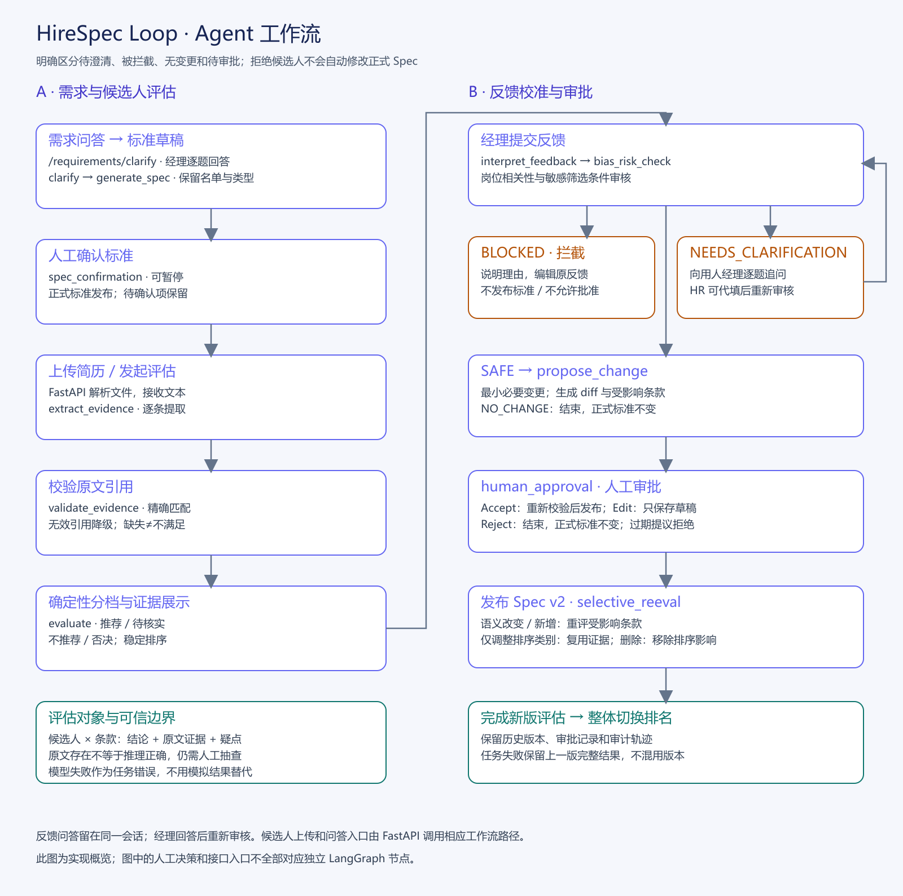

# HireSpec Loop 项目说明

参赛队伍：大秦帝国；赛道：AI软件赛道。

HireSpec Loop 面向企业招聘部门，帮助 HR 与用人经理将模糊招聘需求转化为明确、可执行、可迭代的招聘标准。系统依据简历原文逐条评估候选人，将经理反馈形成可审查的标准修改提议，经人工批准后发布新版本并重评受影响条款。

项目定位是招聘需求校准与证据化决策辅助。最终招聘决定由人作出，系统不生成模型总体评分。

## 一 项目简介

### 用户与问题

主要用户包括 HR、用人经理、猎头和 HRD。招聘中的常见问题是双方对“合适候选人”的理解不一致：HR 推荐后被经理拒绝，但拒绝理由没有沉淀为可复用标准，造成反复推荐和沟通。

本项目将反馈保存为招聘标准的版本变化，并保留对应的证据和审批记录。现阶段为单职位招聘闭环 MVP；目标行业场景及参赛范围需按主办方确认结果填写，当前不声称已获得企业付费客户。

### 核心闭环

需求描述 → 澄清问题 → 经理逐题回答 → 生成 Spec 草稿 → 人工确认 → 导入简历 → 逐条证据评估 → 经理反馈 → 风险审核或澄清 → 修改提议 → 人工审批 → 局部重评与重新分档。

新版先用 `/requirements/clarify` 逐题澄清需求，经理回答后再生成待确认草稿。已明确的公司名单和必须／加分类型保留到具体标准；生成模型漏写时先自动修复。创建后发现的其他待确认问题仍可通过“问题澄清反馈”处理，尚待澄清的条件不能自行补成确定标准。正式标准修改始终需要审批。

### 仓库与演示入口

- 后端：[xihack-ai/xihack-service](https://github.com/xihack-ai/xihack-service)
- 前端：[xihack-ai/xihack-web](https://github.com/xihack-ai/xihack-web)
- 在线演示：[HireSpec Loop 工作台](http://47.243.206.67/workspace?v=20261004-company#requirement)

网站使用团队演示账号登录，用户名为 `demo`，口令由团队另行提供。访问者无需 clone 仓库，也无需提供自己的模型密钥。现有入口为 HTTP 和共享演示认证；尚非具备完整组织权限的生产系统。

## 二 技术栈

| 层级 | 实现 |
|---|---|
| 前端 | Next.js 16、React 19、TypeScript；生产使用静态导出 |
| 后端 | Python、FastAPI、Pydantic |
| 工作流 | LangGraph；人工确认与审批使用 interrupt / Command |
| 大模型 | 接入个人 DeepSeek API Key，调用 DeepSeek 官方 API；当前服务器配置模型为 `deepseek-flash` |
| 简历解析 | AnyDoc 本地解析；支持 PDF、DOC、DOCX、RTF，不调用托管 OCR API |
| 数据库 | PostgreSQL；业务数据、版本、反馈、提议、审计及工作流 checkpoint |
| 部署 | Ubuntu、Nginx、systemd、Docker PostgreSQL |

## 三 已实现功能

| 功能 | 当前行为 | 主要实现 |
|---|---|---|
| 需求校准 | 提炼明确要求，最多提出三个澄清问题，生成待确认草稿 | `app/workflow/nodes.py` |
| 标准管理 | 必须项、加分项、否决项；编辑、增加、移除；审批后发布新版本 | `app/main.py`、`app/schemas.py` |
| 简历导入 | 文本输入、文件上传与本地解析；上传后可选择候选人启动评估 | `app/resume_parser.py` |
| 逐条评估 | 一位候选人 × 一条标准，提取支持或反驳条件的原文 | `app/workflow/nodes.py`、`app/workflow/grounding.py` |
| 引用校验 | 引用必须是解析文本中的连续原文；无效引用不能支撑肯定结论 | `app/hireloop_rules.py`、`hirespec_loop/evaluation.py` |
| 分档与排序 | 推荐、待核实、不推荐、否决；同档按确定性规则排序 | `app/main.py`、`app/workflow/nodes.py` |
| 反馈澄清 | 区分允许、需澄清、拦截；经理逐题回答，HR 可代填 | `app/hireloop_rules.py`、`app/main.py` |
| 变更审批 | 提议展示前后差异；接受、保存编辑草稿、拒绝；接受前不生效 | `app/workflow/nodes.py` |
| 局部重评 | 类别或权重变化只重排；定义变化重评对应条款；新增或删除只处理其影响 | `app/hireloop_rules.py`、`app/workflow/graph.py` |
| 历史与审计 | 版本快照、关联反馈、审批记录和工作流恢复 | `app/store.py`、`app/workflow/graph.py` |

网站主要调用 `/requirements/clarify`、`/jobs` 与 `/calibrations/*` 接口。仓库内另有独立 AI 模块和 `/api/hiring/*` 接口，不应将它们的全部能力视为前端已经接入。

### 标准和判定语义

主工作台每条标准包含 `id`、`type`、`text`、`weight`。类型为 `MUST_HAVE`、`NICE_TO_HAVE`、`VETO`。修改标准应保留已有 ID，已删除 ID 不重新使用。

普通标准的逐条判定为满足、不满足、无证据。不满足需要明确反向证据；简历没有写某项经历只能判无证据。否决项有证据触发时进入“否决”；没有否决项证据不等于已证明安全。

当前分档规则：有否决命中则否决；明确不满足任一必须项则不推荐；全部必须项均无证据则本轮不推荐，但逐条判定仍保留无证据；部分必须项或否决项待核实则待核实；其余推荐。同档位按已满足条款的配置权重及稳定候选人 ID 排序，模型不输出总体分数。

### 反馈审核范围

明确按候选人的年龄、性别、婚育、民族、宗教、种族、残障、外貌筛选时拦截。业务背景中出现相关词，不因关键词直接拦截。混合反馈需要经理编辑原反馈后重新审核，不自动转换为中性条件。

大厂、指定公司、学历、专业、学校背景不因关键词直接禁止；范围或岗位必要性不明确时向经理追问。主动性、冲劲、快节奏等模糊要求同样走澄清。回答后可能继续追问、拦截、无变更或生成待审批提议。

原反馈与历次问答保存为同一反馈会话，澄清回答本身不会发布标准。模型调用失败显示任务错误，不用模拟答案替代。这是当前产品审核规则，不代表法律合规结论。

## 四 系统与 Agent 设计



浏览器请求经 Nginx 进入 FastAPI；FastAPI 负责业务接口、输入校验和同职位操作互斥；LangGraph 组织模型分析、证据校验和人工审批。大模型通过服务端适配器调用，密钥不进入浏览器。AnyDoc 将文件解析为文本，PostgreSQL 保存业务数据与工作流状态。



这里的 Agent 是由 LangGraph 编排、模型参与分析的受控工作流，不是自主执行最终录用决策的机器人。模型负责理解、证据判定与提议；程序负责引用检查、结构与版本校验、确定性排序；经理负责确认和审批。

八张业务表为 `jobs`、`spec_versions`、`candidates`、`evaluations`、`feedback`、`change_proposals`、`candidate_labels`、`audit_events`；LangGraph checkpoint 另由其 PostgreSQL saver 管理。表结构见 `app/schema.sql`。

## 五 本地部署与运行

### 环境

Python 3.11 或以上；Node.js 环境与前端 Next.js 版本兼容；如需持久化，配置 PostgreSQL。服务器当前使用 Python 3.12。本地不配数据库时使用内存，只适合开发，重启不能保证任务恢复。

### 后端

在后端仓库执行以下 PowerShell 命令：

```powershell
python -m venv .venv
.\.venv\Scripts\python.exe -m pip install -e ".[dev]"
```

在后端根目录创建本地 `.env`，填入自己的配置，不提交该文件：

```dotenv
LLM_API_KEY=在本机填写个人DeepSeekAPIKey
LLM_BASE_URL=https://api.deepseek.com
LLM_MODEL=deepseek-flash
REPLAY_ONLY=0
PGHOST=127.0.0.1
PGPORT=5432
PGDATABASE=xks
PGUSER=postgres
PGPASSWORD=在本机填写数据库密码
CORS_ORIGINS=http://localhost:3000,http://127.0.0.1:3000
```

数据库地址应填写自己可连接的实例；通过 SSH 隧道访问远端数据库时使用实际隧道端口。没有可用数据库时省略全部 `PG*` 配置。模型名称须与个人 API Key 的可用模型一致。

```powershell
.\.venv\Scripts\python.exe -m uvicorn app.main:app --host 127.0.0.1 --port 8000
```

API 文档为 `http://127.0.0.1:8000/docs`。未配置有效模型密钥时，AI 请求返回明确错误，不提供模拟结果兜底。

### 前端

在前端仓库创建 `.env.local`：

```dotenv
NEXT_PUBLIC_API_BASE=http://127.0.0.1:8000
```

```powershell
npm ci
npm run dev
```

打开终端显示的网址；默认 `http://localhost:3000/workspace`。如果端口变化，同步更新后端 CORS。

### 服务器部署

服务器以 Nginx 提供静态页面，并将 `/api/` 同源代理到本机 FastAPI。后端与数据库分别只监听本机 8010 和 5432 端口。systemd 使用专用服务账号和加密运行凭据，服务重启后从 PostgreSQL 恢复任务。

前端静态构建设置 `HIRESPEC_STATIC_EXPORT=1`、`NEXT_PUBLIC_API_BASE=/api`。如果设置自定义 `HIRESPEC_BUILD_DIR`，导出文件位于该目录，不能误打包旧 `out/`。新版本独立安装并核验后切换发布链接，旧版本与数据库备份保留用于回滚。

具体部署记录见 [服务器部署文档](docs/SERVER_DEPLOYMENT.md)。

## 六 使用说明

1. 创建职位，输入需求，生成澄清问题和标准草稿。
2. 核对标准，必要时修改类型、文字、权重或移除条款，确认初始 Spec。
3. 在候选人页上传文字型简历并启动评估，查看分档及逐条原文证据。
4. 在“反馈与审批”提交经理理由。若需澄清，由经理选择或填写回答；HR 可代填。
5. 查看修改提议和影响范围。编辑仅保存草稿；点击接受后才发布新版。拒绝保持原标准及评估。
6. 查看局部重评后的结果、版本差异和审计记录。敏感反馈被拦截时，可查看原因并编辑原反馈。

PDF 支持文字型页面。扫描件需 OCR、加密文件需先解锁，当前解析器会明确报错。后端解析限制为单文件10 MB、批次50 MB、最多50份；当前 Nginx 请求体上限为5 MB，在线演示上传还受此更小上限约束。

## 七 API 使用清单

| 服务 | 接入方式 | 用途 | 凭据位置 |
|---|---|---|---|
| DeepSeek 官方 API | 接入个人 DeepSeek API Key；服务端 HTTPS POST `/chat/completions` | 澄清、标准生成、逐条评估、语义审核和反馈提议 | 后端环境变量或服务器加密运行凭据 |
| 赞助商 API | 未接入 | 无 | 无 |
| AnyDoc | 本地 Python 库，不调用托管 API | 简历文字解析 | 不需要 API Key |

前端只请求本项目后端，不直接调用 DeepSeek。默认可复用已有模型响应缓存；验收使用显式 LIVE 模式验证当次真实调用。缓存或回放记录不得宣称为新的实时模型生成。

主要业务接口：

| 操作 | 方法与路径 |
|---|---|
| 创建职位 | `POST /jobs` |
| 创建前逐题需求澄清 | `POST /requirements/clarify` |
| 读取任务 | `GET /calibrations/{job_id}` |
| 确认标准 | `POST /calibrations/{job_id}/spec/confirm` |
| 上传、评估简历 | `POST /calibrations/{job_id}/candidates/upload`、`POST /calibrations/{job_id}/candidates/evaluate` |
| 经理反馈 | `POST /calibrations/{job_id}/feedback` |
| 回答反馈追问 | `POST /calibrations/{job_id}/feedback/answer` |
| 初始问题逐题反馈 | `POST /calibrations/{job_id}/clarification-feedback` |
| 保存提议草稿、审批 | `POST /calibrations/{job_id}/proposal/edit`、`POST /calibrations/{job_id}/approval` |
| 版本与审计 | `GET /calibrations/{job_id}/history` |

## 八 测试与效果验证

2026年10月4日后端回归：223通过、18跳过、0失败。跳过项目主要是需要独立 PostgreSQL 配置的集成测试。自动测试使用明确的模型替身，不证明真实模型准确率。

服务器另以个人 DeepSeek API Key 在 LIVE 模式下，使用模拟输入和真实 PostgreSQL 验证了反馈澄清、提议、批准 v2、敏感反馈拦截及重启恢复。运行机制验证与招聘效果评测分开报告。

- [测试用例与结果](docs/submission/TEST_RESULTS.md)
- [结构化测试结果](docs/submission/test-results.json)
- [pytest 原始 JUnit 记录](docs/submission/test-results.xml)

尚未完成真实经理独立标注的效果评测，不填写真实准确率或 Precision@5。后续在固定校准集与独立测试集上比较关键词基线、Spec v1、Spec v2；测试标签不进入 Prompt 和校准反馈。Precision@5 为前五名中经理标注合适人数除以5。

## 九 团队分工与当前边界

| 角色 | 分工 |
|---|---|
| 队长／后端 | FastAPI、LangGraph、数据库、接口集成 |
| 前端 | 工作台、简历上传、证据展示、反馈与审批交互 |
| AI 逻辑 | Prompt、Schema、证据校验、反馈提议和语义审核 |
| 排序与验证 | 确定性排序、数据标注与评测 |

正式提交时由团队补充真实成员姓名和对应贡献。模型仍可能出现语义误判，原文引用存在不能证明推理正确。当前未实现完整组织权限、HTTPS、生产级隐私管理、触达看板或面试录用结果回流；不将这些列为已完成能力。

## 十 提交材料

| 材料 | 文件 |
|---|---|
| 项目说明文档 | 仓库根目录 `PROJECT.md` |
| 系统架构图 | `docs/submission/system-architecture.svg`、`.png` |
| Agent 工作流图 | `docs/submission/agent-workflow.svg`、`.png` |
| 测试用例与结果 | `docs/submission/TEST_RESULTS.md`、`test-results.json`、`test-results.xml` |

演示视频、路演 PPT、参赛原创性和行业范围确认仍需团队另行准备。本文件未替代这些提交材料。
